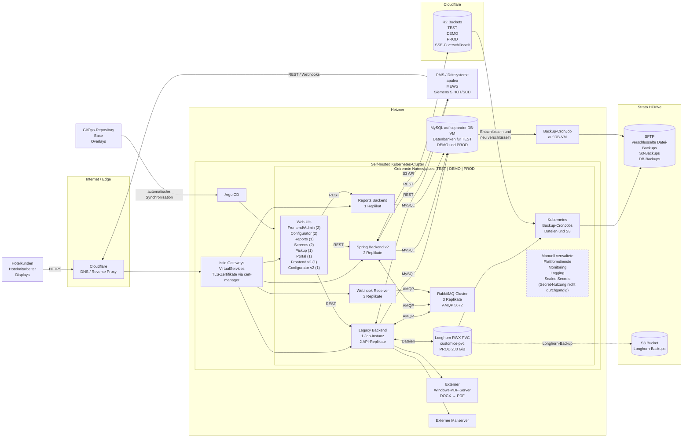

# Architektur der aktuellen Customice-Umgebung

## Systemkontext und Laufzeitarchitektur

Das Diagramm zeigt den aus den GitOps-Dateien und den Bestandsunterlagen
ableitbaren Ist-Zustand. Die drei Namespaces `customice-test`, `customice-demo`
und `customice-prod` folgen grundsätzlich demselben Aufbau. Replikazahlen und
Größen im Diagramm beziehen sich auf Produktion.

Die produktiven öffentlichen Routen sind:

| Route                                                | Kubernetes-Service       |
| ---------------------------------------------------- | ------------------------ |
| `app.customice.de`                                   | Frontend/Admin           |
| `api.customice.de`                                   | Legacy Backend           |
| `app-v2.customice.de`                                | Frontend v2              |
| `api-v2.customice.de`                                | Spring Backend v2        |
| `cfg.customice.de`                                   | Configurator             |
| `cfg-v2.customice.de`, `glc-reservation.siemens.com` | Configurator v2          |
| `reports.customice.de`, `reports-api.customice.de`   | Reports Frontend/Backend |
| `screens.customice.de`                               | Screens                  |
| `pickup.customice.de`                                | Pickup                   |
| `portal.customice.de`                                | Portal                   |
| `webhook.customice.de`                               | Webhook Receiver         |

## Einordnung der Aussagen

### Durch Dateien direkt belegt

- Argo CD wendet `base` und `overlays` automatisch an; Inhalte unter `misc`
  werden laut Repository-README manuell mit `kubectl` verwaltet.
- Die Produktionskonfiguration rendert 13 Deployments, 12 Services und zwei
  Longhorn-PVCs. `customice-pvc-files-v2` (20 GiB) ist definiert, wird in den
  vorhandenen Workload-Manifests aber nicht gemountet.
- Legacy Backend, Spring Backend und Webhook Receiver verwenden den
  RabbitMQ-Cluster `rabbitmq-customice-prod-new`.
- Die DB-Zugangsdaten von Legacy- und Spring-Backend werden aus Kubernetes
  Secrets gelesen; die zugehörigen verschlüsselten `SealedSecret`-Manifeste
  liegen unter `misc/sealed-secrets`.
- Abweichend davon enthält die vom Reports-Backend verwendete ConfigMap die
  vollständige DB-Verbindungs-URL einschließlich Passwort als GitOps-Literal.
- Das Legacy Backend bindet `customice-pvc` ein. Das Spring Backend verwendet
  einen S3-Endpunkt; die Bestandsunterlage identifiziert diesen als Cloudflare
  R2 mit SSE-C.
- Die Pod-Aufnahme aus `customice-prod` zeigt die Anwendungs-Workloads sowie
  drei laufende RabbitMQ-Pods. Der Status `2/2` der Anwendungs-Pods ist mit
  einem zusätzlichen Sidecar vereinbar.

### Aus dem Bestandsdiagramm übernommen

- Cloudflare liegt vor den öffentlich erreichbaren Anwendungen.
- MySQL, PDF- und Mailserver laufen außerhalb von Kubernetes bei Hetzner.
- apaleo und MEWS kommunizieren per REST beziehungsweise Webhooks mit der
  Anwendung.
- Datei- und Datenbank-Backups gehen verschlüsselt zu Strato HiDrive; S3-Daten
  werden aus Cloudflare R2 gelesen und für das Ziel neu verschlüsselt.

### Nicht abschließend verifizierbar

- Die GitOps-Dateien beschreiben den Sollzustand. Ohne Clusterzugriff ist nicht
  feststellbar, ob alle manuell verwalteten Ressourcen unter `misc` aktuell
  installiert sind. Deshalb ist der Plattformdienste-Knoten gestrichelt.
- Das Bestandsdiagramm stammt laut PDF-Metadaten vom 13. August 2024 und kennt
  einige inzwischen in GitOps enthaltene v2-Komponenten noch nicht.
- Die konkreten DB-, S3- und externen Service-Endpunkte liegen teilweise in
  Secrets. Das Diagramm zeigt daher die belegte logische Verbindung, nicht jeden
  Hostnamen oder Netzwerkpfad.

## Quellen

- `src/customice_k8s/base/`
- `src/customice_k8s/overlays/{test,demo,prod}/`
- `src/customice_k8s/misc/`
- `resources/current-system/customice-overview.drawio.pdf`
- `resources/current-system/customice-files-and-backups.drawio.png`
- `resources/current-system/customize-running-pods.png`
